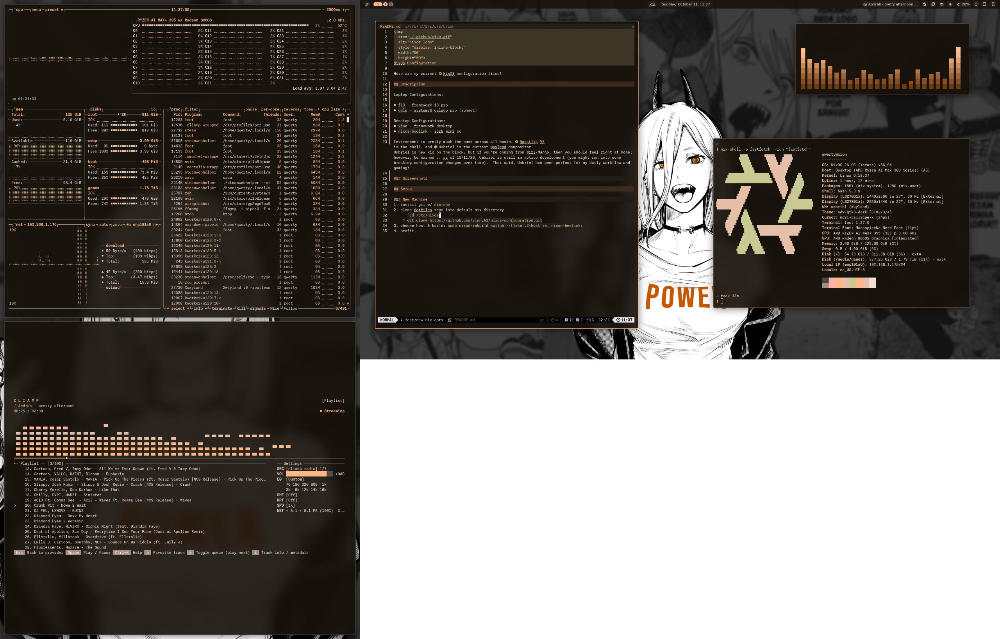

&nbsp;
NixOS Configuration
====

Here are my current [NixOS](https://nixos.org/) configuration files!

## Description

Laptop Configurations:

* `f13` - framework 13 pro
* `galp` - system76 galago pro (sunset)

Desktop Configurations:
* `xion` - framework desktop
* `nixos-beelink` - ser8 mini pc

Environment is pretty much the same across all hosts. [Nocatlia V5](https://docs.noctalia.dev/noctalia/) is the shell, and [Umbriel](https://docs.noctalia.dev/umbriel/) is the current wayland compositor.  Umbriel is new kid on the block, but if you're coming from Niri/Mango, then you should feel right at home; however, be warned .. as of 10/11/26, Umbriel is still in active development (you might run into some breaking configuration changes over time).  That said, Umbriel has been perfect for my daily workflow and gaming!

### Screenshots

&nbsp;

## Setup

### New Machine
1. install git w/ `nix-env`
2. clone dotfiles repo into default nix directory
    - `cd /etc/nixos`
    - `git clone https://github.com/vinnyA3/nixos-configuration.git`
3. choose host & build: `sudo nixos-rebuild switch --flake .#<host ie. nixos-beelink>`
4. profit
